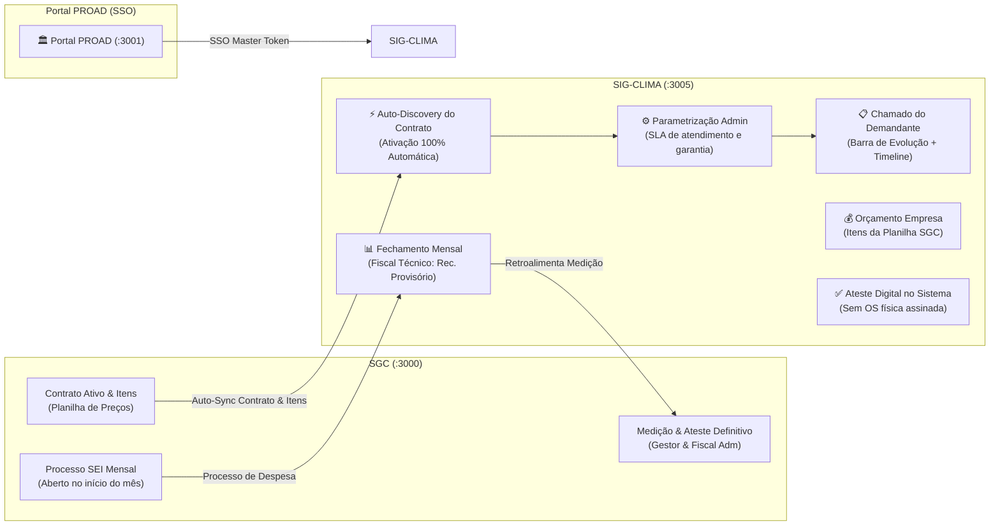
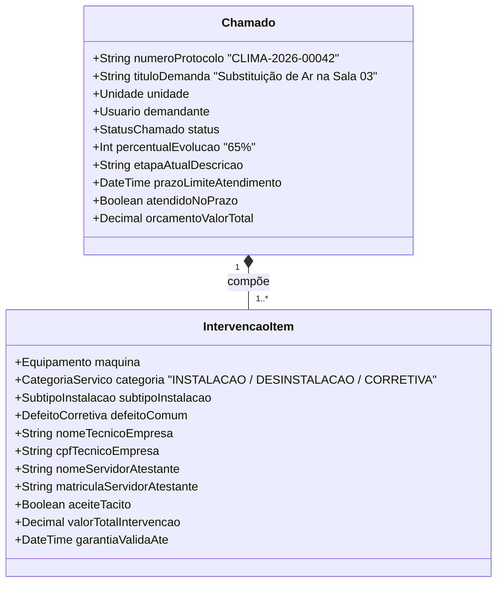

# ❄️ Especificação de Arquitetura Consolidada: SIG-CLIMA UERN
### Sistema de Gestão de Climatização e Refrigeração • PROAD / UERN

---

## 1. Visão Geral e Ecossistema Integrado

O **SIG-CLIMA** opera integrado ao **Portal PROAD** e retroalimenta o **SGC (Sistema de Gestão de Contratos)**, estabelecendo uma esteira digital transparente desde a abertura do chamado pelo servidor até o pagamento mensal da empresa contratada, eliminando papéis físicos e garantindo rastreabilidade jurídica.



---

## 2. Auto-Discovery do Contrato SGC & Parametrização pelo Admin

### 2.1. Ativação 100% Automática
* Ao cadastrar um contrato de climatização e refrigeração no SGC com status `ATIVO`:
  1. O SIG-CLIMA identifica automaticamente o contrato vigente via API interna (`GET /api/integracao/manutencao/contratos`).
  2. Sincroniza a empresa contratada, vigência, saldo contratual e a **tabela completa de itens e preços unitários** (`ContratoItem`).
  3. **Auto-Ativação**: O sistema é automaticamente liberado para a abertura de chamados pelas unidades, sem necessidade de qualquer intervenção manual.

### 2.2. Parametrizações Complementares pelo Admin
O que o Administrador da PROAD / Infraestrutura gerencia no SIG-CLIMA são as variáveis operacionais que podem variar conforme o contrato:
* **SLA de Início de Atendimento**:
  * Atendimento Regular: padrão de 72 horas úteis.
  * Atendimento Prioritário / Emergencial: padrão de 24 horas úteis.
* **Prazo Padrão de Garantia de Serviços e Peças**: padrão de 90 dias (ou 180 dias, conforme edital).
* **Prazo de Ateste pelo Demandante**: 5 dias úteis para teste e ateste antes do disparo do **aceite tácito**.

---

## 3. Orçamento pela Empresa Baseado nos Itens do Contrato SGC

* Quando a empresa faz a visita diagnóstica e orça o conserto:
  * A tela de orçamento **não permite digitação livre de valores arbitrários**.
  * A empresa seleciona diretamente os itens da planilha contratual sincronizada do SGC (ex.: *Higienização Split até 18.000 BTUs - R$ 120,00*, *Troca de Capacitor - R$ 80,00*, *Carga de Gás R410A - R$ 150,00*, *Instalação Split - R$ 350,00*).
  * Informa as quantidades aplicadas e anexa a justificativa técnica.
  * O Admin da PROAD analisa a composição exata antes de aprovar. Ao aprovar, o valor total é deduzido do saldo contratual disponível em tempo real no dashboard.

---

## 4. Barra de Evolução, Timeline e Acompanhamento pelo Demandante

O servidor demandante tem total transparência sobre o andamento da sua solicitação:

### 4.1. Barra de Evolução Visual (Steppers)
Cada chamado exibe uma barra de progresso horizontal intuitiva com 5 grandes etapas:

```
[ 1. Aberto ] ──── [ 2. Diagnóstico/Orçamento ] ──── [ 3. Aprovado/Execução ] ──── [ 4. Aguardando Seu Ateste ] ──── [ 5. Finalizado ]
    (15%)                    (35%)                         (65%)                           (85%)                     (100%)
```

### 4.2. Timeline de Eventos Detalhada
Histórico vertical cronológico em tempo real:
* **Abertura**: Data, hora, servidor solicitante, defeito relatado e fotos.
* **Encaminhamento**: Data do envio à empresa e prazo limite para início do atendimento (SLA).
* **Orçamento**: Data do envio da proposta pela empresa e data de aprovação pelo Admin da PROAD.
* **Execução**: Data de conclusão pela empresa, nome/CPF do técnico executor e fotos antes/depois.
* **Ateste**: Data da validação pelo demandante (ou registro de Aceite Tácito) e nota de avaliação atribuída.

### 4.3. Cards de Cumprimento de Prazo e Garantia
* **Badge de SLA**: *"Atendimento dentro do prazo contratual (Restam 14h de SLA)"* ou *"SLA Cumprido com sucesso"*.
* **Badge de Garantia**: *"Equipamento sob Garantia Ativa até 15/07/2026 (68 dias restantes) - Reparos sem ônus"*.

---

## 5. Estrutura de Chamados: Modelo em 2 Camadas (Chamado + Intervenções)



* **Demandante**: Abre 1 único chamado (ex.: substituição de ar condicionado).
* **Execução**: Vincula as 2 máquinas envolvidas (Desinstalação da Máquina Antiga A + Instalação da Máquina Nova B).
* **Métricas Independentes**:
  * `quantidadeChamados`: Total de demandas administrativas atendidas (1 chamado).
  * `quantidadeMaquinas`: Total de intervenções técnicas faturadas (2 máquinas).

---

## 6. Tipos de Serviço & Defeitos Estruturados

### 6.1. Instalação
* **Instalação substituindo máquina antiga existente**: vincula automaticamente a máquina que está sendo retirada.
* **Instalação nova, com ponto de energia e dreno já existentes**.
* **Instalação nova, sem ponto de energia e sem dreno existentes**.

### 6.2. Desinstalação
* Informa o destino da máquina retirada: depósito da unidade, almoxarifado central ou sucata/baixa patrimonial.

### 6.3. Manutenção Preventiva
* Limpeza de filtros, higienização de serpentina, checagem de isolamento térmico, teste de corrente e pressão de gás.

### 6.4. Manutenção Corretiva (Defeitos Pré-Definidos)
1. **Não gela**
2. **Não liga**
3. **Está pingando dentro da sala**
4. **Ruído excessivo / vibração**
5. **Odor desagradável**
6. **Vazamento visível de gás**
7. **Outro** (campo aberto obrigatório)

---

## 7. Regras de Negócio, Ateste Digital e Garantia

| Regra | Funcionamento no Sistema |
| :--- | :--- |
| **Ateste Digital (Sem OS em Papel)** | O aceite do serviço realizado pelo servidor no sistema substitui formalmente a OS assinada. A empresa anexa fotos antes/depois e laudo técnico (obrigatório caso a máquina seja condenada). |
| **Solução Rejeitada** | Caso o demandante reprove a execução do serviço, o chamado ganha status `REJEITADO_SOLUCAO` e volta imediatamente para a fila da empresa refazer a intervenção. |
| **Bloqueio Anti-Duplicidade** | Enquanto uma máquina estiver vinculada a um chamado com status ativo, seu status fica `EM_MANUTENCAO` e o sistema bloqueia novas aberturas para aquele tombo. |
| **Garantia Ativa (90 dias)** | Ao atestar o serviço, a máquina recebe `garantiaValidaAte = NOW() + 90 dias`. Se apresentar defeito no prazo, o chamado é classificado como `REPARO_GARANTIA` com orçamento em **R$ 0,00**. |
| **Confirmação Tácita (5 dias)** | Prazo de 5 dias úteis para o demandante testar. Ausência de manifestação dispara aceite tácito automático, impedindo retenção de faturamento da empresa. |
| **Tratamento Anti-Viés de Avaliação** | Demandante voluntário: nota de 1 a 5 estrelas. Confirmação tácita: nota padrão **4.0** (satisfatório presumido), evitando que apenas demandantes insatisfeitos pontuem. |
| **Retificação Técnica** | No primeiro atendimento da máquina na unidade, o técnico da empresa pode corrigir marca, BTUs ou modelo incorretamente cadastrados pelo demandante leigo, com log de auditoria. |

---

## 8. Relatório Mensal de Fiscalização Técnica em PDF

Ao final de cada mês, o Fiscal Técnico emite o PDF estruturado para anexação ao processo de pagamento no SEI:

```
========================================================================================
UNIVERSIDADE DO ESTADO DO RIO GRANDE DO NORTE - UERN
PRÓ-REITORIA DE ADMINISTRAÇÃO - PROAD
RELATÓRIO MENSAL DE FISCALIZAÇÃO TÉCNICA - CLIMATIZAÇÃO E REFRIGERAÇÃO
========================================================================================
Contrato nº: 11/2026 • Empresa: L O DOS SANTOS ECOMSER • CNPJ: 63.034.369/0001-35
Processo SEI de Despesa: 04410035.003671/2025-75 • Mês de Referência: 04/2026
Resumo: 18 Chamados • 23 Máquinas Atendidas • Valor Total Medido: R$ 8.450,00
----------------------------------------------------------------------------------------
ITEM | TOMBO  | UNIDADE/LOCAL           | SERVIÇO / ITENS CONTRATUAIS        | VALOR (R$) | TÉCNICO (NOME / CPF)     | ATESTE UERN (NOME / MATRÍCULA) | DATA ATESTE
01   | 104521 | FAFIC - Sala 04         | Corretiva (Carga Gás R410 + Cap.)  | R$ 230,00  | José Silva (123.***.***) | Maria Souza (12345-6)          | 08/04/2026
02   | 108932 | PROAD - Gabinete        | Instalação Substituição Split 24k  | R$ 380,00  | Carlos Lima (456.***.***)| João Paulo (23456-7)           | 11/04/2026
03   | 104110 | PROAD - Gabinete        | Desinstalação Máquina Antiga       | R$ 120,00  | Carlos Lima (456.***.***)| João Paulo (23456-7)           | 11/04/2026
04   | 109201 | CAMPUS-ASSU - Lab 02    | Corretiva (Pingando dentro da sala)| R$ 150,00  | Marcos Dias (789.***.***)| Aceite Tácito (Art. 15 / 5 d)  | 18/04/2026
----------------------------------------------------------------------------------------
TERMO DE RECEBIMENTO PROVISÓRIO:
Atesto provisoriamente a execução dos serviços acima discriminados, em conformidade com as
especificações do Contrato nº 11/2026.
Fiscal Técnico: Prof. Dr. Fernando Santos • Matrícula UERN: 98765-4 • Data: 30/04/2026
========================================================================================
```

---

## 9. Padrão Visual e Identidade dos Sistemas da PROAD

O SIG-CLIMA seguirá a estética visual unificada da PROAD:
* **Dark Slate Moderno**: Fundo `slate-950`, cartões `slate-900/80` com bordas sutis `white/10`.
* **Cores Institucionais**: Azul Marinho Profundo (`#002244`), Dourado/Amber da PROAD e acentos em **Cyan/Cool Blue** para caracterizar o módulo térmico de climatização.
* **Componentes**: Barra de progresso de chamado com indicadores coloridos, cards de SLA com contagem regressiva e badges de status padronizados.
